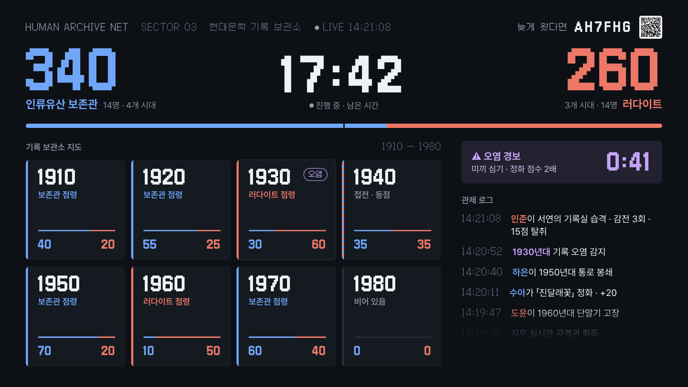
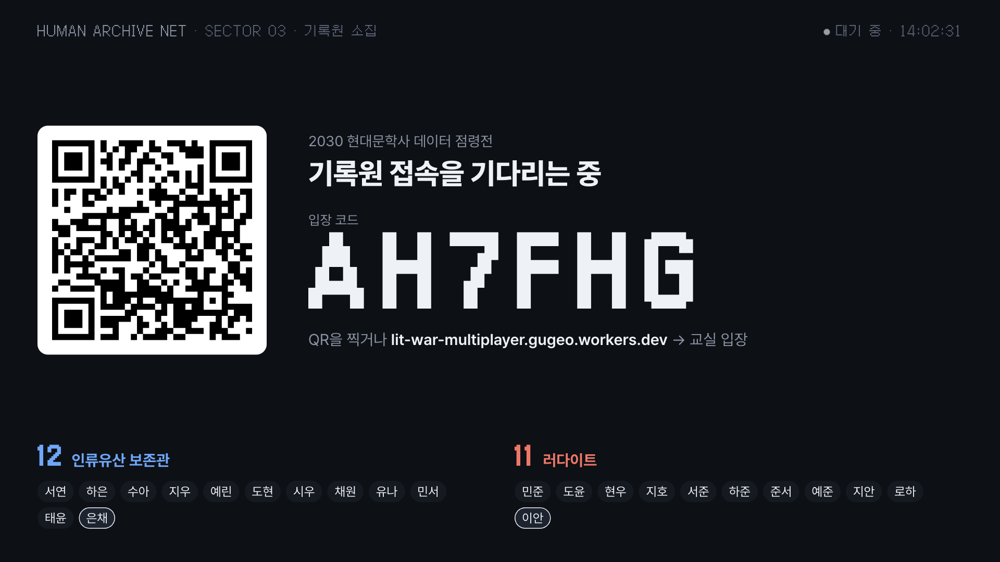
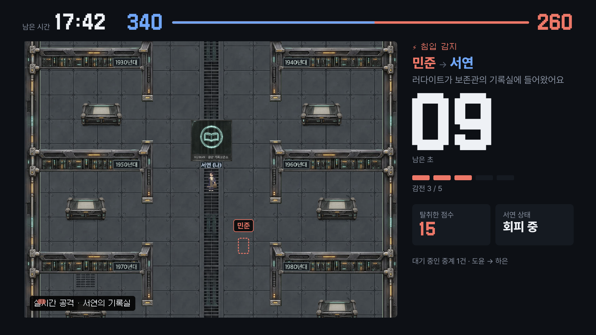
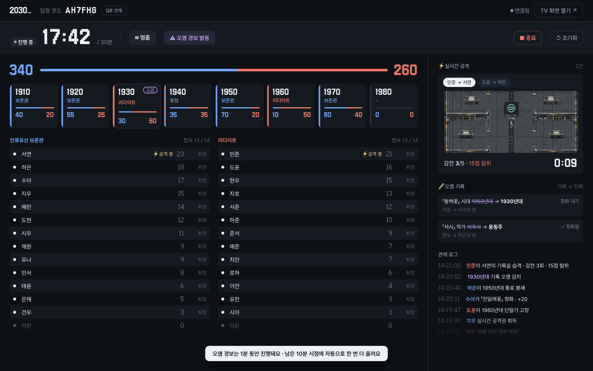
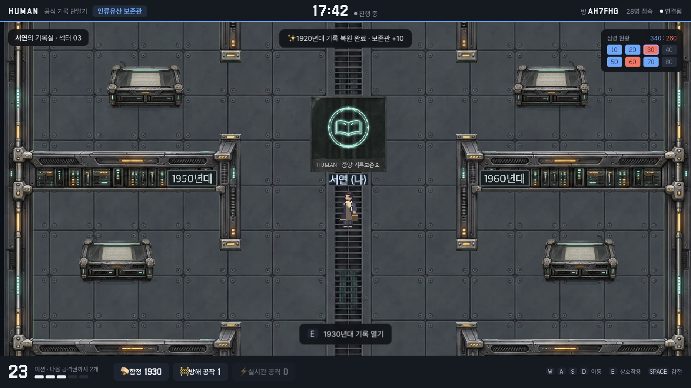
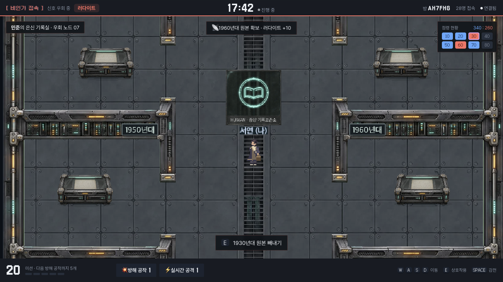

# Claude 시안 v1 — 2030 데이터 점령전 화면 3종

[요청문](../SCREEN-DESIGN-PROMPT.md)의 규칙에 맞춰 만든 정적 시안입니다. HTML 파일을 브라우저로 열면 그대로 보입니다(인터넷 연결 필요: 글꼴·QR을 CDN에서 불러옴). 이름·점수는 가짜 데이터(`data.js`)이고, 게임 화면은 실제 게임을 캡처한 `game.png`입니다.

| 화면 | 크기 | 시안 | 이미지 |
|---|---|---|---|
| TV · 진행 중(오염 경보 포함) | 1920×1080 | [tv-playing.html](tv-playing.html) |  |
| TV · 입장 대기 | 1920×1080 | [tv-lobby.html](tv-lobby.html) |  |
| TV · 실시간 공격 중계 | 1920×1080 | [tv-raid.html](tv-raid.html) |  |
| 교사 · 진행 중 | 1440×900 | [teacher.html](teacher.html) |  |
| 학생 · 보존관 | 1366×768 | [student-guardian.html](student-guardian.html) |  |
| 학생 · 러다이트 | 1366×768 | [student-luddite.html](student-luddite.html) |  |

## 1. 디자인 체계 (`system.css`)

**색** — 바탕 3단계 + 글자 3단계 + 의미 색 3개만 씁니다.

| 역할 | 값 | 쓰는 곳 |
|---|---|---|
| 바탕 / 면 / 올린 면 | `#0c1016` / `#141a22` / `#1b2330` | 화면 / 카드·띠 / 버튼·칩 |
| 선 | `#252e3b` | 구분선, 빈 막대 |
| 글자 / 보조 / 흐림 | `#edf1f6` / `#8792a3` / `#566173` | 본문 / 설명 / 시각·시스템 표기 |
| 보존관 | `#5ea8ff` (+12% 투명 배경) | 점수, 점령 띠, 이름 |
| 러다이트 | `#ff6f61` (+12% 투명 배경) | 점수, 점령 띠, 이름 |
| 경보 | `#c9a2ff` | 오염 경보·오염 표시에만 |

**글꼴** — 두 가지 역할로만 나눕니다.
- 갈무리11 Bold: 시간, 점수, 연도, 입장 코드, 시스템 줄(`HUMAN ARCHIVE NET`), 로그 시각
- Pretendard: 그 밖의 모든 문장·라벨·버튼

**글자 크기 단계**

| 화면 | 작은 글씨 | 본문 | 제목 | 큰 숫자 |
|---|---|---|---|---|
| TV | 24 | 26~30 | 44~56 | 112~200 |
| 교사 | 12~13 | 14 | 16~22 | 28~40 |
| 학생 | 12~13 | 14~15 | — | 24~28 |

**간격·모서리·선** — 간격은 4의 배수(교사 8~24, TV 16~72). 모서리는 카드 12px, 버튼·칩 8px(러다이트 화면만 2px로 각지게). 테두리 상자는 쓰지 않고, 면의 밝기 차이로 영역을 나눕니다. 선은 헤더 아래 구분선, 학생 화면 위쪽의 진영색 2px 선만 씁니다.

**상태 표시** — 작은 점 하나로 표시합니다. 흰 점 = 접속, 깜박이는 점 = 실시간 진행 중, 흐린 점 = 꺼짐. 시대 점령은 칸 왼쪽 6px 띠(보존관 파랑 / 러다이트 빨강 / 동점 줄무늬 / 빈 칸 회색)와 라벨 글자색, 그리고 아래쪽 점수 비율 막대로 보여 줍니다. 오염은 보라 테두리 칩 하나로만 표시합니다.

## 2. 화면별 메모

- **TV 진행 중**: 가장 큰 세 숫자(보존관 점수 · 남은 시간 · 러다이트 점수)를 한 줄에 놓고, 아래 얇은 줄다리기 막대로 우세를 보여 줍니다. 오염 경보는 평소에는 없고, 발동하면 로그 위에 보라 띠로만 나타납니다.
- **TV 입장 대기**: QR과 코드가 주인공이고, 아래에 진영별로 들어온 이름이 쌓입니다. 방금 들어온 이름은 테두리로 잠깐 강조합니다.
- **TV 공격 중계**: 평소 전황은 위 한 줄(남은 시간·점수·막대)로 접고, 실제 게임 화면을 크게 보여 줍니다. 오른쪽에 공격자 → 방어자, 남은 초, 감전 칸 5개, 탈취 점수, 대기 중인 중계를 둡니다.
- **교사**: 위 조작 띠에는 현재 상태와 **지금 누를 수 있는 버튼만** 둡니다(진행 중이면 멈춤·경보, 오른쪽 끝에 종료·초기화). 학생 28명이 스크롤 없이 진영별 두 열에 들어가고, 오른쪽 열에 공격 중계(탭)·오염 기록·관제 로그가 있습니다. TV는 별도 창(`TV 화면 열기`)으로 분리하는 것을 전제로 했습니다.
- **학생**: 위 44px·아래 64px 띠를 빼고는 모두 게임 화면입니다(현재 약 58% → 약 86%). HUD는 게임 위의 반투명 칩(방 이름·점령 지도·알림·상호작용 안내)과 아래 띠(미션 수·다음 권한까지 칸·행동 버튼·조작법)로만 구성합니다. 보존관과 러다이트는 **배치가 완전히 같고** 위쪽 문구·선 색·모서리·주사선만 다릅니다. 러다이트에 없는 함정 버튼 자리는 비워 두어 버튼 위치가 같게 유지됩니다.

## 3. '상황판다움'을 위해 쓴 요소

| 요소 | 이유 |
|---|---|
| 시스템 줄 `HUMAN ARCHIVE NET · SECTOR 03 · ● LIVE 14:21:08` | 맨 위의 작고 흐린 한 줄만으로 '관제 시스템' 세계관을 알린다. 정보를 가리지 않는다. |
| 갈무리 숫자 | 영상·게임과 같은 글꼴이라 한 세계로 묶인다. 숫자에만 써서 시끄럽지 않다. |
| `기록 보관소 지도` · `관제 로그` 같은 이름 | 같은 칸이라도 이름만으로 상황판처럼 읽힌다. |
| 시각이 붙은 로그 | 실제 관제 기록처럼 시간순으로 쌓인다. |
| 깜박이는 LIVE 점 | 실시간이라는 느낌을 가장 작은 움직임으로 준다. |
| 경보 때만 나타나는 보라 띠 + 미세한 주사선 | '신호 간섭'을 사건이 있을 때만 보여 준다. |
| 진영별 단말기 문구(`HUMAN 공식 기록 단말기` / `[ 비인가 접속 ] 신호 우회 중`) | 같은 정보를 보는 시점이 다르다는 세계관을 문구로 표현한다. |

## 4. 일부러 뺀 요소

| 뺀 것 | 이유 |
|---|---|
| 모든 영역의 테두리 상자, 계단 모서리 픽셀 프레임 | 1안이 조잡해 보인 가장 큰 원인. 여백과 면 밝기로 충분하다. |
| 시대 칸 전체를 팀 색으로 칠하기 | 8칸이 모두 칠해지면 화면이 색 덩어리가 된다. 왼쪽 띠와 글자색으로 충분하다. |
| 노란 속보 자막(티커) | 관제 로그와 같은 정보를 두 번 보여 준다. 움직이는 글자는 TV에서 눈을 피곤하게 한다. |
| 배경 격자·줄무늬 막대 | 장식일 뿐 정보가 없다. |
| 민트·노랑 강조색 | 팀 2색 + 경보 1색 규칙. HUMAN의 민트·노랑은 오프닝 영상과 보존관 홍보물에 맡긴다. |
| 학생 화면의 소개 문구·푸터 | 게임 화면을 좁힌다. 세계관 문장은 오프닝 영상이 맡는다. |

## 5. 정해야 할 것

1. **TV를 교사 화면과 분리할지** — 시안은 분리를 전제로 했습니다(교사 노트북 = 조작, TV = `teacher.html?tv` 별도 창). 노트북 한 대에서 화면 미러링으로 TV에 띄운다면 지금처럼 같은 화면을 전환하는 방식이 필요합니다.
2. **줄다리기 막대 확정 여부** — README에 '점수 비교 vs 줄다리기'가 미정으로 남아 있습니다. 시안은 막대를 점수 비율로 그렸습니다(게임 규칙은 바꾸지 않음).
3. **보존관 화면에 HUMAN 민트·노랑을 쓸지** — 지금은 색 규칙 때문에 파랑만 썼습니다. 오프닝과 더 이어지게 하려면 보존관 학생 화면에 한해 민트를 허용할 수 있습니다.
4. **종료 화면에 '활약한 학생'을 넣을지** — 미션 수 1등을 보여 주면 동기 부여가 되지만, 하위 학생이 드러나지 않게 1~3등만 보여 줄지 정해야 합니다.
5. **학생 화면 점령 지도 위치** — 오른쪽 위 작은 칩으로 두었습니다. 크롬북에서 게임 시야를 가리면 아래 띠로 옮길 수 있습니다.
6. **글꼴 불러오기** — Pretendard·갈무리를 CDN에서 불러옵니다. 학교 네트워크가 CDN을 막으면 `public/`에 글꼴 파일을 넣어야 합니다(둘 다 OFL 라이선스).
