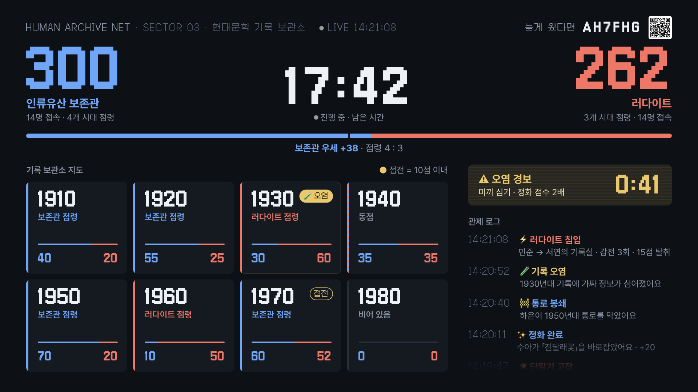
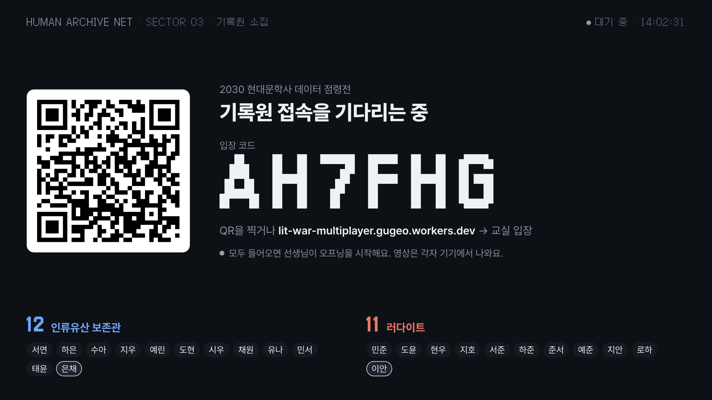
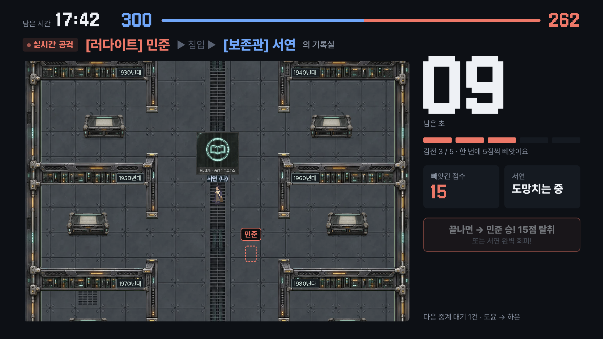
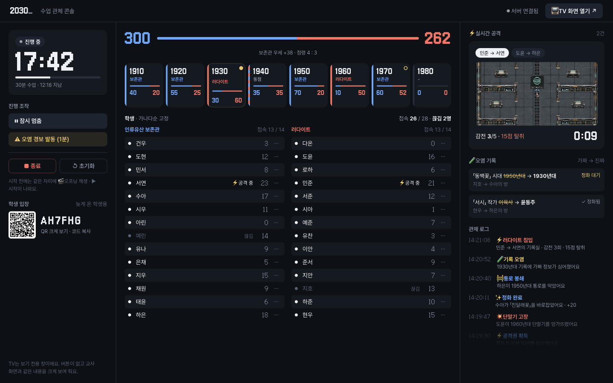
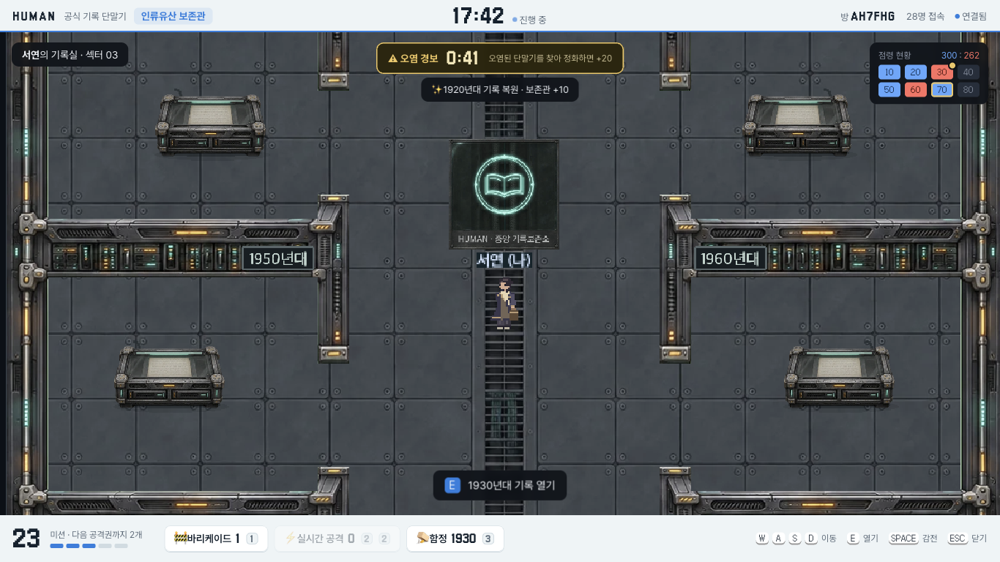
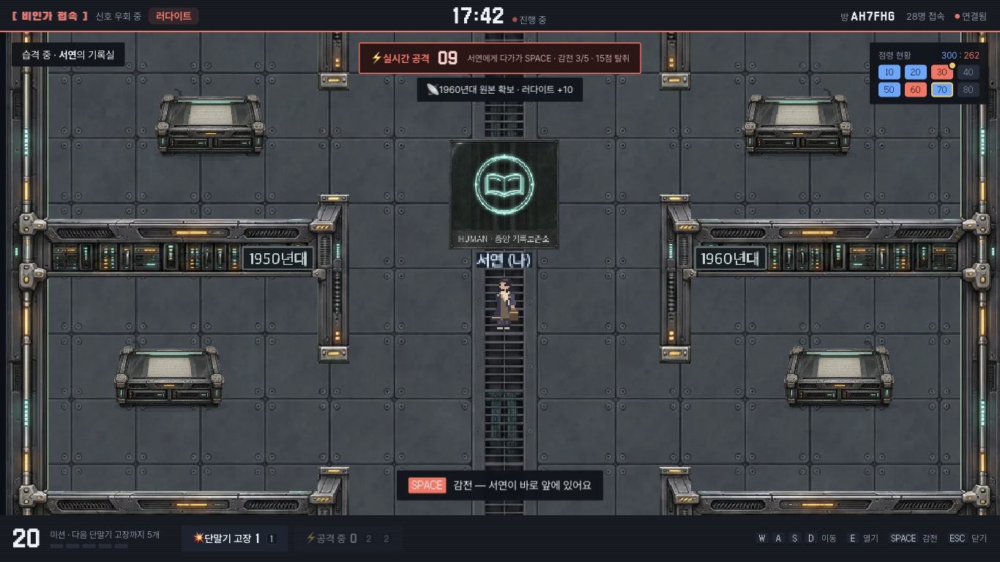

# 통합 시안 v2 — Claude · Gemini · GPT 종합

[종합 문서](../SYNTHESIS.md)의 결정을 모두 반영한 시안입니다. 이 시안을 기준으로 실제 화면을 바꿉니다. HTML을 브라우저로 열면 보입니다(글꼴·QR은 CDN에서 불러오므로 인터넷 필요). 점수·이름은 가짜 데이터(`data.js`)이고 게임 화면은 실제 캡처(`game.png`)입니다.

| 화면 | 크기 | 시안 | 이미지 |
|---|---|---|---|
| TV · 진행 중 (오염 경보 중) | 1920×1080 | [tv-playing.html](tv-playing.html) |  |
| TV · 입장 대기 | 1920×1080 | [tv-lobby.html](tv-lobby.html) |  |
| TV · 실시간 공격 중계 | 1920×1080 | [tv-raid.html](tv-raid.html) |  |
| 교사 · 진행 중 | 1440×900 | [teacher.html](teacher.html) |  |
| 학생 · 보존관 (오염 경보 중) | 1366×768 | [student-guardian.html](student-guardian.html) |  |
| 학생 · 러다이트 (공격 중) | 1366×768 | [student-luddite.html](student-luddite.html) |  |

## 반영한 결정

| 결정 | 시안에서 |
|---|---|
| 경보색 = 노랑 `#f0c65d` | 오염 경보 띠, 오염 칩(노랑 채움), 접전 칩(노랑 테두리)에만. 공격·감전은 빨강 |
| 접전 = 점수 차 10점 이하(동점 제외) | TV `1970 · 접전` 칩, 교사 화면 작은 노랑 점, 학생 점령 지도 노랑 테두리. 완전 동점은 `동점` |
| 시대 별칭 폐기 | 시대 칸에는 연도·점령 상태·점수만 |
| 단축키 1/2/3 | 학생 화면 버튼에 키 표시. 2는 `2` `2`(두 번) |
| 보존관 학생 화면 = 밝은 틀 | 위·아래 띠가 밝은 HUMAN 공식 단말기. 지도 위 칩은 진영과 상관없이 어둡게(게임 화면 위라서) |
| TV와 교사 화면 분리 | 교사 화면 오른쪽 위 `📺 TV 화면 열기`. TV는 보기 전용 |
| 명단 가나다순 고정 | 끊긴 학생(예린·지호)은 제자리에서 흐리게 + `끊김`, 위에 `끊김 2명`. 퇴장은 `⋯` 안 |

## 각 시안에서 가져온 것

- **Claude**: 큰 숫자 세 개 한 줄(TV), 실제 게임 중계 화면, 큰 남은 초, 입장 이름 칩, 학생 위·아래 얇은 띠, 30명 스크롤 없는 명단
- **Gemini**: 공격 중계 한 줄 제목(`[러다이트] 민준 ▶ 침입 ▶ [보존관] 서연의 기록실`), 진영색 E 키, 보존관 밝은 틀
- **GPT**: 교사 화면 3열 구조(왼쪽 조작 열), 점수 보조 문구(`보존관 우세 +38 · 점령 4 : 3`), 로그의 '굵은 사건 + 상세' 구조, 가운데 위 알림 칸 하나, 결과 카드, `⋯` 퇴장 메뉴, 보존관 밝은 틀

## 상태별 메모 (시안에 없는 화면)

- **TV 오프닝 상영 중**: 입장 대기 화면 배치를 그대로 두고, 가운데 문구를 `오프닝 시청 중`, 이름 칩을 시청 완료한 학생만 진하게 바꾼다. 아래에 `시청 완료 18 / 28명`.
- **TV 멈춤**: 진행 화면 위에 반투명 막 + 가운데 `⏸ 잠시 멈춤`. 남은 시간은 멈춘 값 그대로.
- **TV 종료**: 큰 숫자 세 개 자리에 승리 진영과 최종 점수, 아래 기록 보관소 지도는 최종 점령 상태로 고정.
- **교사 시작 대기·오프닝**: 왼쪽 조작 열 같은 자리에 `🎬 오프닝 재생`, 시간 입력, `▶ 시작`(오프닝 중엔 전원 시청 전까지 잠김), `기다리지 않고 시작`. 명단의 상태 칸에 오프닝 상태(⬇ 40% / ▶ 시청 중 / ✓ 완료).
- **학생 알림 칸**: 오염 경보(노랑)와 공격 배너(빨강)가 같은 자리를 쓴다. 둘이 겹치면 공격이 우선.

## 실제 적용 순서

1. 공용 디자인 체계(`system.css`의 색·글꼴·부품)를 게임 코드로 옮기고 글꼴 파일을 직접 포함
2. TV 보기 전용 화면(새 페이지) → 교사 화면 개편
3. 학생 화면 위·아래 띠와 지도 위 칩
